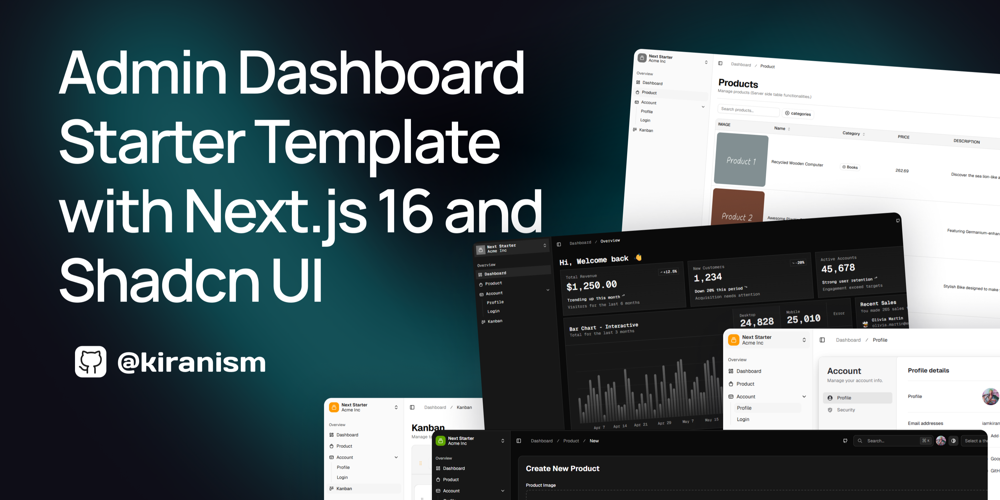

<h1 align="center">Robotics Club Equipment Lending Tracker</h1>

<div align="center">An internal web app for managing equipment loans, members, and inventory for a university Robotics Club.</div>

<br />

<div align="center">
  
</div>

<br />

## Overview

Built for a university Robotics Club with ~80 active members and a storage room full of equipment. Replaces a paper notebook with a proper system that tracks:

- What equipment exists and where it is
- Who has borrowed what and when it's due back
- What's overdue and needs chasing
- Reports for club management

Three staff roles use it: **Admin**, **Lab Assistant** (day-to-day operations), and **Executive** (read-only access).

## Tech Stack

| | |
|---|---|
| Framework | Next.js 16 (App Router), React 19 |
| Language | TypeScript 7 |
| Styling | Tailwind CSS v4, shadcn/ui |
| Database | SQLite via Prisma 6 |
| Auth | NextAuth v5 (email + password) |
| Forms | TanStack Form + Zod |
| Tables | TanStack Table v9 |
| Package manager | npm |

## Pages

| Route | What it does |
|---|---|
| `/dashboard/overview` | Stat cards, items due soon, most overdue |
| `/dashboard/equipment` | Full inventory — add, edit, bulk add |
| `/dashboard/members` | Club members — add, edit, view loan history |
| `/dashboard/loans` | Issue loans, record returns, extend due dates |
| `/dashboard/overdue` | All items past their due date |
| `/dashboard/reports` | 6 report tabs with date range filter |
| `/dashboard/users` | Admin only — manage staff accounts |
| `/dashboard/settings` | Change your own password |

## Getting Started

**1. Install dependencies**

```bash
npm install
```

**2. Set up environment**

Create `.env` at the project root:

```env
DATABASE_URL="file:./prisma/dev.db"
```

Create `.env.local` at the project root:

```env
DATABASE_URL="file:./prisma/dev.db"
AUTH_SECRET="your-random-secret-here"
AUTH_URL="http://localhost:3000"
APP_TIMEZONE="Asia/Dhaka"
LOAN_DEFAULT_DAYS=7
MEMBER_LOAN_WARN_LIMIT=5
```

Generate a secret with:
```bash
node -e "console.log(require('crypto').randomBytes(32).toString('base64'))"
```

**3. Set up the database**

```bash
npx prisma migrate deploy
npx tsx prisma/seed.ts
```

**4. Start the app**

```bash
npm run dev
```

Open [http://localhost:3000](http://localhost:3000)

## Default Login Credentials

| Email | Password | Role |
|---|---|---|
| `admin@robotics.club` | `admin123` | Admin |
| `lab@robotics.club` | `admin123` | Lab Assistant |
| `exec@robotics.club` | `admin123` | Executive |

> Change these after first login via the Settings page.

## Useful Commands

```bash
npm run dev            # start dev server
npm run build          # production build
npm run typecheck      # TypeScript check
npm run format         # format with Prettier
npx prisma studio      # browse the database visually
npx prisma migrate dev --name <name>   # create a new migration
```

## Project Structure

```
prisma/
├── schema.prisma       # database schema (source of truth)
├── seed.ts             # sample data
└── migrations/         # migration history

src/
├── app/
│   ├── (auth)/login/   # login page
│   ├── actions/        # server actions (all writes go here)
│   ├── api/            # route handlers (auth, overdue count)
│   └── dashboard/      # all main pages
│
├── components/
│   ├── ui/             # shadcn/ui components
│   ├── layout/         # sidebar, header, page container
│   ├── equipment/      # equipment-specific UI
│   ├── members/        # member-specific UI
│   ├── loans/          # loan dialogs and tables
│   ├── overdue/        # overdue table
│   ├── reports/        # report tabs
│   └── icons.tsx       # all icons registered here
│
├── server/
│   ├── auth.ts         # NextAuth config
│   ├── db.ts           # Prisma client
│   └── services/       # all database queries live here
│
└── lib/                # utilities, form setup, validation schemas
```

## Roles

| Role | Permissions |
|---|---|
| `ADMIN` | Full access — manage users, delete records, everything |
| `LAB_ASSISTANT` | Issue/return loans, add equipment and members |
| `EXECUTIVE` | Read-only — view everything, change nothing |

## License

MIT
